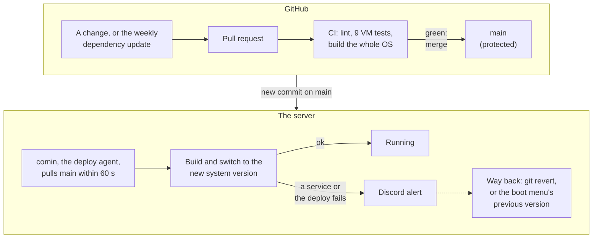
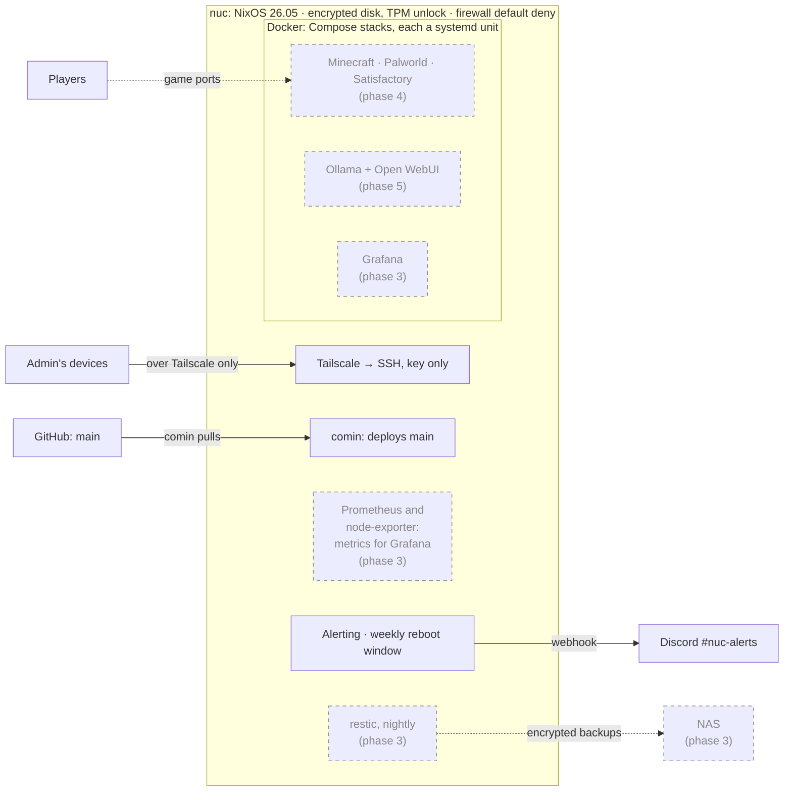

# nixos-homeserver

[](https://github.com/alexCranfield/nixos-homeserver/actions/workflows/ci.yml)
[](https://github.com/alexCranfield/nixos-homeserver/actions/workflows/update-flake-lock.yml)
[](LICENSE)

A home server run the way production infrastructure is run: every change is a
pull request that CI (continuous integration) tests in VMs (virtual machines)
before it can merge, the server deploys `main` to itself, failures alert a
phone, and both ways back from a bad change have been drilled. The
machine is an ASRock Industrial NUC BOX-358H (Intel Core Ultra X7 358H, 96 GB
DDR5, 1 TB NVMe) running NixOS, and will host game servers, local LLMs (large
language models) and development shells.

## How a change reaches the server



- **Nothing is changed by hand.** The server's whole operating system is
  described by the files in this repo, and changes reach it as pull requests
  to `main`.
- **CI proves the change first.** It builds the complete system and boots it
  in nine VM tests: SSH, disk encryption, network, Tailscale, the deploy
  agent, the reboot window, alerting, Docker and Compose stacks. `main` only accepts a merge once that
  passes.
- **The server pulls its changes.** [comin](https://github.com/nlewo/comin)
  on the server notices the merge within a minute and switches to it, so no
  CI system holds SSH or other credentials for the server
  ([ADR (Architecture Decision Record) 0003](docs/adr/0003-pull-deploy-comin.md)).
  Apart from an emergency `just deploy` over SSH, which comin replaces at the
  next merge ([deploy runbook](docs/runbooks/deploy.md)), only what merges to
  `main` reaches it.
- **Both ways back are drilled.** A failed service or deploy posts to Discord
  within a minute (54 s in the drill). A bad change is undone with
  `git revert` (a revert of the latest deploy currently also needs comin
  restarted, #123), and a change that breaks booting by choosing the previous
  version in the boot menu ([rollback drill](docs/runbooks/rollback.md)).

## How the host is built

[NixOS](https://nixos.org) builds the whole operating system, from disk layout
and kernel to users, firewall and services, from this repo as one unit. The
same commit always produces the same system, so there is no configuration
drift and the server can be rebuilt from scratch.

- **Generations.** Each deploy is a new, complete system version, a
  generation, next to the old one, and switching between them is atomic.
  The last ten stay in the boot menu.
- **Pinned dependencies.** `flake.lock` fixes the exact revision of every
  input. It changes only through the weekly update pull request, which lists
  the changes and the CVE (Common Vulnerabilities and Exposures) report and
  goes through CI like any other change, once Alex closes and reopens it to
  start CI (#61) ([updates](docs/runbooks/updates.md)).
- **Modules.** `modules/base` holds what every host gets (SSH, firewall,
  Tailscale, deploy agent, alerting); `hosts/nuc` holds what is particular to
  this machine. [Layout](#layout) lists every file.

## Practices

| Practice | Evidence |
|---|---|
| Infrastructure as code, reproducible builds | [ADR 0001](docs/adr/0001-nixos.md), `flake.nix`, `flake.lock` |
| Protected `main`: pull requests only, CI required to merge | [CI runbook](docs/runbooks/ci.md), [`.github/workflows/ci.yml`](.github/workflows/ci.yml) |
| Integration tests in VMs; every pull request shows its evidence, including the check broken on purpose and seen to fail | [`tests/`](tests), [pull request template](.github/pull_request_template.md), [closed pull requests](https://github.com/alexCranfield/nixos-homeserver/pulls?q=is%3Apr+is%3Amerged) |
| Pull-based deployment from Git (GitOps) | [ADR 0003](docs/adr/0003-pull-deploy-comin.md), [deploy runbook](docs/runbooks/deploy.md) |
| Secrets encrypted in Git, decrypted only on the host | [ADR 0004](docs/adr/0004-secrets-sops.md), [secrets runbook](docs/runbooks/secrets.md) |
| Container ports private unless declared in Nix: loopback by default, undeclared ports dropped by the firewall, compose files checked in CI | [ADR 0006](docs/adr/0006-docker-vs-podman.md), [Docker runbook](docs/runbooks/docker.md), [stacks runbook](docs/runbooks/stacks.md) |
| No admin ports on the LAN: SSH by key, over Tailscale only | [ADR 0005](docs/adr/0005-tailscale.md), [Tailscale runbook](docs/runbooks/tailscale.md) |
| Full-disk encryption unlocked by the TPM (Trusted Platform Module) | [ADR 0009](docs/adr/0009-disk-encryption.md), [install runbook](docs/runbooks/install.md) |
| Automated dependency updates with a supply-chain cooldown | [updates runbook](docs/runbooks/updates.md) |
| Kernel reboots only in a weekly maintenance window | [updates runbook](docs/runbooks/updates.md) |
| Alerting on failures, boots and shutdowns | [notifications runbook](docs/runbooks/notifications.md) |
| Rollback drilled on the real machine, with timings | [rollback runbook](docs/runbooks/rollback.md) |
| Rebuild from scratch: a full wipe and reinstall, timed | [reinstall runbook](docs/runbooks/reinstall.md) |
| Decisions and procedures written down | [ADRs](docs/adr/), [runbooks](docs/runbooks/), [build plan](docs/PLAN.md) |

## What runs on it



Solid boxes run today; dashed boxes are planned, with the phase that builds
them. See [docs/PLAN.md](docs/PLAN.md).

## Reproduce it

The server is built from nothing by following
[docs/runbooks/reinstall.md](docs/runbooks/reinstall.md): boot a NixOS live
USB, run `nixos-anywhere` from a workstation to partition, encrypt and install
in one step, then enrol the TPM. On first boot the server decrypts its own
secrets, joins the tailnet (the private Tailscale network) and from then on
deploys itself from `main`. The runbook was followed end to end on 2026-10-19,
a full wipe, in about 73 minutes of work against a one-hour goal, most of the
overrun spent waiting at the console; the record is at its end.

To try the configuration without the hardware, `just vm` boots it in a local
VM, and `just check` runs everything CI runs (see [Tasks](#tasks)).

## Layout

```
flake.nix                          inputs, nixosConfigurations.nuc, formatter, checks
flake.lock                         pinned revisions; commit every change
hosts/nuc/default.nix              the host: imports disko, hardware + base; encrypted-boot settings
hosts/nuc/disko.nix                the disk: ESP (EFI System Partition), btrfs in LUKS2 (Linux Unified Key Setup), swapfile
hosts/nuc/network.nix              the LAN port by MAC address, DHCP, nothing open on the LAN
hosts/nuc/notify.nix               the nuc's Discord webhook and role, from sops
hosts/nuc/hardware-configuration.nix   kernel modules, detected on the nuc (#13)
hosts/installer/default.nix        live USB: latest kernel, survey tools, ops key
keys/ops.pub                       the admin SSH public key (private half on the workstation)
modules/base/default.nix           config applied to every host; imports the files below
modules/base/ssh.nix               the ops account and key-only sshd
modules/base/firewall.nix          default-deny firewall on nftables, forwarded traffic included
modules/base/tailscale.nix         Tailscale, with SSH open on the tailnet
modules/base/nix.nix               Nix settings and weekly garbage collection
modules/base/system.nix            UTC clock, locale, boot menu retention, git and tmux
modules/base/comin.nix             comin: the host deploys itself from `main`
modules/base/reboot-window.nix     weekly window that reboots only for a new kernel or kernel parameters
modules/base/notify.nix            Discord alerts: failed units and deploys, boot, shutdown
modules/base/vm.nix                SSH into `just vm` on 127.0.0.1:2222; no effect on a real host
modules/containers/docker.nix      rootful Docker: ports on loopback unless named, nobody in the docker group
modules/containers/compose-stack.nix   homeserver.stacks: a compose file becomes stack-<name>.service; public ports, limits, crash alerts
modules/containers/stack-watch.sh  the crash watcher's loop: posts container crashes to Discord
stacks/hello/                      the example stack: compose.yml, and default.nix declaring it
modules/dev/vm-secrets.nix         test-only: proves sops-nix decrypts in a VM (virtual machine)
tests/base-ssh.nix                 VM test: key-only SSH as ops, root refused (a flake check)
tests/comin.nix                    VM test: comin runs, fetches `main`, ignores a testing branch
tests/comin.py                     its test script
tests/reboot-window.nix            VM test: kernel and kernel-parameter changes reboot in the window, a config change does not
tests/reboot-window.py             its test script
tests/disk-tpm.nix                 VM test: the real layout boots, then unlocks from an emulated TPM (Trusted Platform Module)
tests/disk-tpm.py                  its test script, in Python; disk-tpm.nix passes in the values only Nix knows
tests/network.nix                  VM test: reserved address on lan0, nuc.home.arpa, a LAN scan finds nothing open
tests/network.py                   its test script
tests/tailscale.nix                VM test: ops logs in over the tailnet from another network, which sees only SSH
tests/tailscale.py                 its test script
tests/notify.nix                   VM test: failed units and deploys, boot and shutdown post to a stand-in webhook, with the cooldown
tests/notify.py                    its test script
tests/docker.nix                   VM test: published ports bind to loopback on every network; controls without each setting
tests/docker.py                    its test script
tests/compose-stack.nix            VM test: stacks as units, slices and limits, public ports enforced, crash alerts; controls
tests/compose-stack.py             its test script
tests/compose-check.nix            flake check: compose files under stacks/ against ADR 0006, with a failing fixture per rule
tests/compose-check/               the fixtures
.sops.yaml                         which age keys can decrypt which files
secrets/                           sops-encrypted secrets; ciphertext only
scripts/tickets.py                 ticket definitions; file_issues.py files them
scripts/check_compose.py           the compose checker the flake check runs
scripts/flake_update.py            the weekly flake.lock update: cooldown, report, checks on the new lock
scripts/firmware-boot-loop.sh      measures whether local KVM (Kernel-based Virtual Machine) boots the disk-tpm firmware reliably (#80)
.github/workflows/ci.yml           CI (continuous integration): runs just check on every pull request and push to main
.github/workflows/update-flake-lock.yml   weekly pull request updating flake.lock (docs/runbooks/updates.md)
.github/                           issue and pull request templates, CODEOWNERS
.editorconfig                      whitespace and indentation for editors
```

Build the whole system without a machine:

```bash
nix flake check                                                    # evaluates and builds
nix build .#nixosConfigurations.nuc.config.system.build.toplevel   # the OS as one derivation
nix fmt                                                            # format the tree
```

## Tasks

`direnv` loads the flake's devShell on `cd`, putting `just`, `sops`, `age`,
`ssh-to-age`, `nixos-anywhere` and `nixos-rebuild` on `PATH` at versions pinned
by `flake.lock`. Without direnv, prefix anything below with `nix develop -c`.

| Target | Does |
|---|---|
| `just` | list the targets |
| `just fmt` | format every file in place |
| `just check` | everything CI runs: `nix flake check`, build the closure, check formatting and `.editorconfig`, lint the workflows |
| `just build` | build the nuc closure, print its store path |
| `just iso` | build the live USB image, print its store path ([hardware.md](docs/runbooks/hardware.md)) |
| `just vm` | boot the nuc config in a local VM; log in as below; quit with ctrl-a then x |
| `just vm-secrets` | prove sops-nix decrypts in a VM; exits non-zero on failure |
| `just vm-test-tcg <test>` | run one VM test under TCG (Tiny Code Generator) software emulation, without KVM, e.g. `disk-tpm` when it fails locally before Linux starts (#80) |
| `just deploy` | emergency deploy of the current checkout to the nuc; comin deploys `main` by itself ([deploy.md](docs/runbooks/deploy.md)) |
| `just secrets-edit <file>` | edit an encrypted secret, re-encrypting on save |
| `just secrets-show <file>` | print a secret without opening an editor |
| `just secrets-rekey <file>` | re-encrypt after changing recipients in `.sops.yaml` |

`just check` is the single source of truth for what CI runs:
`.github/workflows/ci.yml` calls it rather than restating the commands (see
[docs/runbooks/ci.md](docs/runbooks/ci.md)). `just vm-secrets` exits
non-zero when decryption fails, because the VM powers off with status 0 either
way and only the console distinguishes them.

To log in to `just vm`, wait for its login prompt, then from a second terminal:

```bash
ssh -i ~/.ssh/id_nuc -p 2222 -o UserKnownHostsFile=/dev/null -o StrictHostKeyChecking=no ops@127.0.0.1
```

While the VM is still booting, QEMU already accepts the connection, so ssh
just hangs; that means wait, not broken. Under software emulation, booting
takes a minute or more.

The forward listens on 127.0.0.1 only, so the VM is not reachable from the LAN.
The `-o` options are for VMs only, as for the
[live USB](docs/runbooks/hardware.md): `just vm-secrets` boots from a fresh
directory every run, and deleting `.vm/` does the same for `just vm`, so the
host key on that port keeps changing.

Two habits worth keeping. Use `secrets-show` rather than `secrets-edit` when you
only want to look: saving from an editor rewrites the file with a fresh MAC and
timestamp, producing a diff that claims a secret changed when it did not. And
`secrets-rekey` is required after editing `.sops.yaml`; adding a recipient there
does not re-encrypt anything on its own.

## Documents

- [docs/PLAN.md](docs/PLAN.md): the phased build plan. Each ticket is a GitHub Issue under a phase milestone.
- [docs/adr/](docs/adr/): architecture decision records.
- [docs/runbooks/](docs/runbooks/): operational procedures, added as phases complete.
- [docs/learning.md](docs/learning.md): reading list, sequenced against the phases.
- [docs/q-and-a/](docs/q-and-a/): questions asked during the build, with answers, kept for revision.

## Status

| Phase | State |
|---|---|
| [0. Workstation and repo foundations](https://github.com/alexCranfield/nixos-homeserver/milestone/1) | Done; the machine user for bot pull requests (#61) remains |
| [1. Bare-metal install and base OS](https://github.com/alexCranfield/nixos-homeserver/milestone/2) | Done: installed 2026-10-18, wiped and reinstalled from the runbook 2026-10-19; follow-ups open |
| [2. GitOps, updates, rollback](https://github.com/alexCranfield/nixos-homeserver/milestone/3) | Live: self-deploy (#16), weekly updates (#17), reboot window (#18), rollback drill (#19) and alerting (#20). Open: whether to auto-merge update pull requests (#17, due late November) and two comin bugs (#110, #123) |
| [3. Containers, observability, backups](https://github.com/alexCranfield/nixos-homeserver/milestone/4) | Started: Docker is live (#22); Compose stacks run as systemd units, with public ports declared in Nix and enforced by the firewall (#23). Next: the data layout (#24) |
| [4. Game servers](https://github.com/alexCranfield/nixos-homeserver/milestone/5) | Planned |
| [5. Local LLMs](https://github.com/alexCranfield/nixos-homeserver/milestone/6) | Planned |
| [6. Development environment](https://github.com/alexCranfield/nixos-homeserver/milestone/7) | Planned |
| [7. Hardening, disaster recovery, write-up](https://github.com/alexCranfield/nixos-homeserver/milestone/8) | Planned |
| [8. Kubernetes (stretch)](https://github.com/alexCranfield/nixos-homeserver/milestone/9) | Planned |

Each ticket is a GitHub issue under its phase's milestone, closed by a pull
request with its evidence; [docs/PLAN.md](docs/PLAN.md) records how each was
built.

## License

GPL-3.0. See `LICENSE`.

## Filing the tickets

`scripts/tickets.py` holds every ticket from the plan. To create the milestones, labels and
issues (idempotent, safe to re-run):

```
GITHUB_TOKEN=<token with Issues: write> python3 scripts/file_issues.py
```
