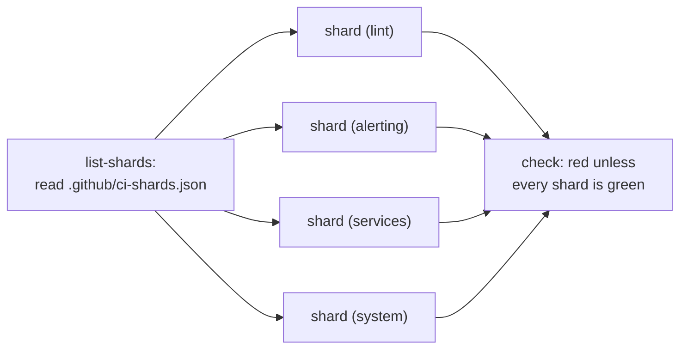

# CI (continuous integration)

What runs on GitHub when a pull request (PR) is opened or `main` changes, why it
is built the way it is, and what to do when it goes red. Ticket 0.4 (#4).

## What runs

`.github/workflows/ci.yml` runs on GitHub-hosted Ubuntu runners. It triggers on
every pull request, every push to `main`, and by hand from the Actions tab
(`workflow_dispatch`). Since #180 the checks are split into shards, each a job
on its own runner, so the VM (virtual machine) tests run side by side:



- **`list-shards`** reads the shard names from `.github/ci-shards.json`, the
  one list of which flake check runs where, with a line on why each shard
  holds what it does.
- **`shard (<name>)`**, one job per shard, checks out the repo, installs Nix
  and runs:

  ```sh
  nix develop --command just check-shard <name>
  ```

- **`check`** needs every shard and passes only if every one succeeded. See
  "One required check over the shards" below.

`just check-shard <name>` evaluates that shard's checks, then builds them in a
second process (see "Evaluation and builds apart" below). The `lint` shard
also runs, first, `nix flake check --no-build` to evaluate every output and
`just check-shards-complete`, and last `nix fmt -- --ci`, `actionlint` and
`editorconfig-checker`, which
holds every file git does not ignore to `.editorconfig` (line endings, final
newline, trailing whitespace, tabs). That includes untracked files, so a stray
scratch file in the tree fails `just check` locally until it is removed or
ignored. `just check`, the target you run locally, does all of it in one go:
the lint shard's evaluation and lint, and every shard's checks in a single
build. The workflow does not restate
those commands, so changing what "checked" means is a change to the `justfile`
or to `.github/ci-shards.json`, and the workstation and CI change together.

`check` is a required status check on `main` (ruleset `main`), so a PR cannot
merge while it is red or still running.

### Adding a check

A new entry in the flake's `checks` must go into exactly one shard of
`.github/ci-shards.json`. Until it does, `just check-shards-complete` fails
the `lint` shard, and so `check`, with `not in any shard: <name>`. A check
listed in two shards, a name that is not a check, a shard with no checks, a
shard name that is not lower-case letters and digits, and a file with no
`lint` shard fail it too. It reads only the checks' names, so it takes about
two seconds:

```sh
just check-shards-complete
```

To run what one CI job runs, `just check-shard <name>`, for example
`just check-shard services`.

## Reproducing a failure locally

Run the failing shard's command from the repo root, or everything:

```sh
just check-shard <name>    # the shard from the failed job's name, shard (<name>)
just check
```

If it passes locally but fails in CI, the difference is almost always one of:

- **An uncommitted change.** Locally, a flake sees every file git tracks,
  including edits not yet committed (Nix warns that the tree is dirty). CI sees
  only what was pushed. `git status` first.
- **Running outside the dev shell.** With a globally installed `just`, or a
  stale direnv cache, `nix` is the workstation's Determinate Nix rather than the
  server's version. `nix develop -c just check` matches CI exactly.
- **Formatting.** `just fmt`, commit, push.

### A VM test that fails before Linux starts, on the workstation

On the workstation, `disk-tpm` often fails before the kernel prints anything
(#80). The VM's console shows one of three forms after `starting vm`:

- an exception from the firmware: `!!!! X64 Exception Type - 0E(#PF -
  Page-Fault)`, or `0D(#GP …)` or `06(#UD …)`;
- no output at all;
- the systemd-boot menu, then nothing.

The test then fails with `neither a prompt nor a boot` or a timeout, in
whichever subtest booted the VM. Each boot is bounded at ten minutes. A
hung boot shows as a single QEMU (Quick Emulator) process using a whole core.
To give up sooner, stop the `nix build` client, which cancels the build;
the QEMU process belongs to a Nix build user, so your own account cannot kill
it directly. (Before #80 the first boot was unbounded and held the test for its
one-hour limit.)

**This is the workstation, not the change under test.** Rerun that one test
without KVM (Kernel-based Virtual Machine), under TCG (Tiny Code Generator),
QEMU's software emulation:

```sh
just vm-test-tcg disk-tpm
```

It takes about ten minutes instead of three. A pass there is a real pass; a
failure there is a real failure to investigate. CI has not hit this failure: none
of the repo's 92 runs up to 2026-10-18 shows a firmware exception, and none has
failed since 2026-10-04, while the test was first being written (#9).

**The cause, as far as it is known.** The failure needs KVM on this
workstation. That KVM is nested: it runs inside the virtual machine of WSL2
(Windows Subsystem for Linux), on Hyper-V. WSL is 2.4.11, its kernel is
5.15.167, and the processor is AMD, so the module is `kvm_amd`. Under it,
firmware crashes or hangs at random, most often when the firmware uses SMM
(System Management Mode) and talks to a TPM (Trusted Platform Module).
`disk-tpm` exists to test exactly those two things. The nesting, the old
kernel and the CPU vendor are the suspects, but none was tested on its own.
GitHub's hosted runners are themselves virtual machines (on Azure, so most
likely Hyper-V too), and they do not fail. No upstream report of this exact failure was
found.

`scripts/firmware-boot-loop.sh` boots the test's firmware, with no disk, over
and over. Healthy firmware reaches its shell in about three seconds. Twenty
boots per row, 2026-10-18, with QEMU 10.2.4's full build:

| Setup | Failed |
|---|---|
| As the test runs it: KVM, OVMF (Open Virtual Machine Firmware) with SMM, TPM | 14 (11 hung, 3 crashed) |
| Same, `-cpu host` instead of `-cpu max` | 13 |
| KVM, SMM, no TPM | 4 (crashed) |
| KVM, no SMM, TPM | 3 (hung) |
| KVM, SMM, TPM, `-machine kernel-irqchip=split` | 5 (crashed) |
| KVM, no SMM, TPM, `kernel-irqchip=split` | 1 (crashed) |
| KVM, no SMM, no TPM | 0 |
| **As the test runs it, but TCG instead of KVM** | **0** |

`nix flake check` runs VM tests with a smaller build of the same QEMU,
`qemu_test`, which the script uses. Re-measured with it the same day: 12 of 20
boots failed under KVM (9 hung, 3 crashed) and none of 10 under TCG.

The same firmware and devices are clean once KVM is out of the path, and the
failures come before Linux starts, so the NixOS configuration under test plays
no part. A firmware bug that only KVM's timing exposes cannot be ruled out, but
CI runs the same firmware under KVM without failing. None of the QEMU options
above makes KVM reliable, and turning off SMM or the TPM would remove what the
test checks, so the test is left as it is. The full test under TCG passed all
ten subtests in 618 seconds.

To measure the rate again, for example after a WSL update:

```sh
scripts/firmware-boot-loop.sh 20 kvm    # exits non-zero if any boot failed
scripts/firmware-boot-loop.sh 20 tcg    # the control
```

A full `disk-tpm` run boots the firmware four times, so the loop's rate would
predict nearly every run failing. In fact about half failed on 2026-10-18. Why
the two differ is not known: the test's boots have a disk and a boot loader,
and the rate itself moves within a day. The full test's rate also varies from
day to day: about one run in three failed on 2026-10-17
and about half on 2026-10-18, with the same code.

## Decisions and why

**The checks run with the server's Nix.** The dev shell includes `pkgs.nix`,
which is what NixOS defaults `nix.package` to, so `nix` inside `nix develop` is
the exact version comin will evaluate with on the server (2.34.8 as of
2026-09-27). The flake check `devshell-nix-matches-server` fails if a host ever
overrides `nix.package`, so the two cannot drift silently. The CI log's "Enter
dev shell" step prints both versions. See the amendment to ADR (Architecture
Decision Record) 0007.

That step is also the first to evaluate `flake.nix`, so a syntax error in
`flake.nix` itself fails there. Errors in `hosts/` or `modules/` fail inside
`just check-shard`: in the `lint` shard with the `nix flake check` log, and
in any shard whose checks they reach.

**Upstream Nix via `cachix/install-nix-action`, not Determinate's installer.**
The installed Nix only starts the dev shell and builds. The ticket named
`DeterminateSystems/nix-installer-action`, which now installs Determinate Nix by
default and calls upstream Nix unsupported and possibly removed later. The
upstream installer keeps third-party distributions out of the pipeline that
gates the server.

**Checks that have not changed are not rerun (#137).** Nix names each
check's output after everything that goes into it, so a change that touches
none of a check's inputs leaves its output path the same, and `nix flake
check` skips any check whose output is already in the store. Every run used
to start with an empty store and rerun all 14 checks, VM tests
included, whatever changed: a docs-only pull request took 24 minutes,
and so did the run on `main` after it merged, though none of its checks had
changed. Editing a comment in a `.nix` file that is only imported changes no
check either, because the comment never reaches a derivation. (A file a
derivation takes as a path, such as `src = ./.`, would be different: its text
is an input. No check takes one today.)

The workflow now carries the store between runs in GitHub's Actions cache,
with `nix-community/cache-nix-action`. Each shard has caches of its own,
keyed `nix-Linux-<shard>-…`, and holds only its own checks (#180):

- **Restore**, before `just check-shard`: the newest cache of the same shard
  this branch can see, which for a re-run is the earlier attempt's if that
  attempt saved one. GitHub looks on the pull request's own branch first,
  then on `main`. The prefix is `nix-Linux-<shard>-`, and shard names have no
  hyphen (`just check-shards-complete` fails on one), so `nix-Linux-vm1-`
  could never match a shard `vm1-x`'s keys.
- **Trim**, after it, even when a check failed: every check whose output
  exists is made a garbage-collection root, and everything else is deleted
  from the store. A failed check has no output, so it runs again next time.
  Build inputs and the dev shell are fetched from cache.nixos.org again, which
  keeps the cache small. The checks' derivations come from a file,
  `$CHECK_DRVS`, that `just check-shard` writes as it evaluates them (one
  `name drv` line per check), rather than from evaluating the flake again,
  which took three minutes. Before #180 they were parsed out of `nix flake
  check`'s log, which only the lint shard still runs. If the file is
  missing, as when the recipe fails before writing it, the step warns and
  nothing is saved, and CI still reports the checks' result. A wrong list
  can only leave a check out of the cache, never make one pass: an output
  exists only once its check has built.
- **Save** the trimmed store under `nix-Linux-<shard>-<commit>-<attempt>`, unless it
  holds nothing the restored cache lacked, as after a docs-only change. The
  attempt number is there because a saved cache cannot be replaced. On
  2026-10-24 the first run on `main` after #138 failed on the Tailscale flake
  (#130) and saved a 0.19 GB partial store under its commit. The re-run
  passed, but no new cache appeared: `main` still held only that 0.19 GB
  one afterwards. With the
  attempt in the key, a re-run restores the failed attempt's cache, builds
  what it lacks, and saves its own.

GitHub keeps a branch's caches to that branch: a pull request can read
`main`'s cache but writes only its own, so code under review cannot plant a
result that `main` later trusts. It can plant one that its own later runs
trust, though: the code a run executes outside Nix's sandbox (the `justfile`,
the workflow, the dev shell) could mark outputs as built that never were, and
a later push that reverts those files would restore them and pass. Pull
requests from forks therefore never use the cache, and run in full every time.
Branches of this repository do: they are pushed only by Alex, Claude, and the
flake.lock workflow's bot (`update/flake-lock`, a lock written and checked by
`scripts/flake_update.py`). comin builds
on the nuc and never reads this cache; it only decides which checks CI
reruns.

The trade-off: a check that passed once is not rerun until its inputs
change, so a flaky test that passed by luck stays passed, which is what
#130 was. To rerun everything, delete the caches (Actions, Caches, or
`gh cache delete --all`) and re-run the job.

The repo gets 10 GB of cache. GitHub deletes the least recently used caches
past that, and any cache not used for seven days. Before #180 the single cache
was about 2 GB (2.02 GB on `main` on 2026-10-30), so about five fit. Nearly
all of that is the host's closure, now in the `lint` shard's cache. A VM
test's output is its log and references nothing (a `vm-test-run-…` output
on the workstation: 96 bytes, no references), so a VM shard's trimmed store
is small, and the four shards together cost about what one cache did. A
pull request's first run restores `main`'s newest cache of each shard; its
later pushes restore their own. Without cleanup, every push that builds
something adds another 2 GB under the pull request (three pushes to #138
made 4.7 GB), and `main`'s caches, the least recently used, would be the
ones deleted. `.github/workflows/ci-cache-cleanup.yml` deletes all but the
newest cache of each shard of a pull request on each push, and all of them
when it closes. It groups by the key without its last two parts, the commit
and attempt; keeping only the newest overall, as it did with one cache,
would delete every other shard's on each push. Each open pull request then
holds, per shard, the cache its latest run restored and the one it saved,
or three after a re-run that saved, until the next push or
`gh cache delete`. The caches from before #180, `nix-Linux-<commit>-<attempt>`,
match no shard's prefix and are never restored again; GitHub expires them
after seven days, or `gh cache delete` removes them sooner. A fork's run saves nothing unless the fork edits `ci.yml`; such
caches are not cleaned up, and GitHub expires them after seven days. If `main`'s is evicted anyway, the next
run is a full one, as before #137, and saves a new cache. To see what is
stored: Actions, Caches, or `gh cache list`.

Paths filters are not used. `on.pull_request.paths-ignore` skips the whole
workflow, so the required check `check` never reports, and GitHub holds the
pull request at "Expected — waiting for status". A filter would also need a
hand-kept list of paths that cannot affect a check; Nix already knows.

**VM tests run in CI.** Since #10, `just check` also runs
`base-ssh`, a NixOS test that boots two VMs and logs in over SSH. NixOS tests
require the `kvm` system feature. `install-nix-action` provides it on GitHub's
Linux runners (`enable_kvm`, on by default; the job log shows "Enabled KVM"),
and with it the test takes about 25 seconds; the first run, on #71, finished in
under two minutes in all. If the build instead stops because no machine has the
`kvm` and `nixos-test` features, the runner lost KVM
access; the test itself is not at fault. Locally, without KVM access,
the test falls back to software emulation and takes about four minutes;
`docs/runbooks/workstation.md` has the udev rule that fixes that.

**Two builds at a time.** The runner has 16 GB of memory and four CPUs, and
Nix's default would build four derivations at once, which with the VM tests
means four tests booting together. On 2026-10-24 (#133) that happened twice:
`tailscale`, `docker`, `reboot-window` and `base-ssh` started within nine
seconds, about ten VMs asking for 10 GB, and a few minutes later GitHub
stopped the runner ("The runner has received a shutdown signal", the build
killed by signal 9). The same commit's tests had passed on `main` only because
they happened to start minutes apart. `max-jobs = 2` (the `extra_nix_config`
of `install-nix-action`) keeps it to two tests, at most about 7 GB with the
largest two (`docker`, 4 GB; `compose-stack`, 3 GB); the job timeout went from
30 to 45 minutes to allow for the slower run, and to 90 on 2026-10-29
(#27): the alerting test waits out real alert durations, retries and
"nothing posted again" windows, and with it a change to the host, which
reruns every host VM test, was cancelled at 45 minutes. By 2026-10-30 such
a run took 76 minutes, and #164's `dns` test would have pushed it past 90;
#180 split the checks into shards (below), each with two build slots on
its own runner, and #182 split the alerting test in two and shortened its
waits. A run that
touches no host test still takes minutes, since the cache skips the
unchanged checks. A cancelled run saves no cache, so a plain re-run of a
timed-out job times out again. A runner killed this way shows no
test failure in the log, only the shutdown message: look at which VM tests
started just before it.

**Evaluation and builds apart.** Two builds at a time was not the whole
story. On 2026-10-25 (UTC) `main` was stopped the same way twice (#141), with no
more than two tests running. A run that sampled memory every 20 seconds
showed why: evaluating the 15 checks took 15.9 GB and 1.5 GB of swap before
any test started, and `nix flake check` kept that memory while it built
them, so two VM tests booting on top left 113 MB free, with swap use flat
at 3 GB.
Disk never fell below 72 GB free. Two changes, measured on the workstation
with caching off (`nix flake check --no-build --no-eval-cache`):

- Eight tests set `node.pkgsReadOnly = false`, because the host sets
  `nixpkgs.hostPlatform`. Without `nixpkgs.pkgs`, every machine and every
  specialisation in them then imported its own copy of nixpkgs. They now
  set `defaults.nixpkgs.pkgs = pkgs`, which took evaluation from 14.7 GB
  to 10.4 GB (70 s to 50 s). No check's derivation changed, so nothing was
  rebuilt and every test checks what it did before.
- `just check` evaluates with `nix flake check --no-build`, whose process
  exits, then reads the checks' derivations with a separate `nix eval`
  (9.6 GB, about 45 s, also gone before anything builds) and builds them with
  `nix build`, which evaluates nothing. Since #180 only the `lint` shard runs
  `nix flake check --no-build`; each shard's `nix eval` reads only its own
  checks, so a VM shard evaluates less than this. The VM tests now have the runner's
  memory to themselves, at the cost of evaluating the checks twice. One
  difference: `nix flake check` skipped a check whose output could be
  downloaded, and `nix build` downloads it. Only
  `devshell-nix-matches-server`, an empty file, is affected.
- `--no-build` evaluates with a read-only store, so evaluation cannot add
  anything to it. A test that interpolated `"${pkgs.path}/…"` copied all of
  nixpkgs into the store and failed on a cold runner with `path … is not
  valid`; it now uses `pkgs.path + "/…"`, which reads the file in place.

If the runner is stopped again, a sampler like the one on #141 tells memory
from disk in one run.

**Shards, balanced by measured time (#180).** One job with two build slots
ran every VM test one or two at a time, and a change to the host reruns
nearly all of them. The run on `main` after #179 (2026-10-30) shows the
shape: `alerting` held one slot for about 50 minutes, while the other ran
the remaining tests one after another in about 50 minutes too
(`observability` about 12, `compose-stack` and `notify` about 6.5 each,
`announce` 5.5, `docker` and `disk-tpm` 4 to 5, `tailscale` 3.5, `network`
3, the rest 2 or less). Those durations are the gaps between the
`building '…vm-test-run-<name>.drv'` lines in the job log, since Nix
prints when a build starts but not when it ends. The shards in
`.github/ci-shards.json`:

| Shard | Checks | Expected, all rebuilt |
|---|---|---|
| `lint` | `nix flake check --no-build`, the shard check, the host's closure, the checks with no VM, format and lint | about 10 minutes |
| `alerting` | `alerting-a`, with `base-ssh`, `reboot-window`, `game-access` and `network` in its second slot | about 20 minutes: `alerting-a` sets the floor |
| `services` | `observability`, `docker`, `compose-stack`, `stack-data`, `announce` | about 20 minutes |
| `system` | `alerting-b`, with `tailscale`, `comin`, `notify` and `disk-tpm` in its second slot | about 20 minutes |

The expected times add a few minutes per shard for its runner, Nix, the
cache and evaluation to the test times above; the pull request that made
the shards records the measured ones. A shard
is a whole runner, so each keeps `max-jobs = 2` and the memory limits above
hold per shard.

**The alerting test in two halves (#182).** Until #182 `alerting` was one
test of about 50 minutes, nearly all of it waiting: every resolved post
waited out the rules' 2 minute grace for scrape gaps (`keep_firing_for`)
and then up to a minute of Alertmanager's `group_interval`, and the fixed
sleeps were sized around both. The test now sets the grace to 30 seconds
and `group_interval` to 40 (the host keeps 2 and 5 minutes;
`tests/alerting.nix` says why each test value is what it is), derives
every sleep from those, and runs as two checks on the same machine:
`alerting-a` (subtests 4, 1, 6, 7, 8) and `alerting-b` (2, 3, 5); both run
subtests 9 and 10, which take seconds. The split is by expected time
rather than by number: subtest 5 alone waits out `OomKill`'s 5 minute
window, about 10 minutes, and the expected totals are about 16 minutes
each. The halves are in different shards, `alerting` and `system`, so they
run side by side; each shares its runner with tests that together take no
longer than it does. On the workstation under TCG, much slower than CI's
KVM, `alerting-a` took 999 seconds and `alerting-b` 1181 (2026-10-31); the
pull request records the times measured in CI. When a shard grows past the others, move checks between
shards, or add one: a new key in `.github/ci-shards.json` is a new matrix
job, with no change to the workflow. Every shard costs a runner start and
an evaluation of the host, a few minutes, so fewer, fuller shards are
cheaper than many small ones.

**One required check over the shards.** Ruleset `main` requires a status
named `check`, and the matrix jobs report as `shard (lint)` and so on, so a
last job named `check` needs every shard (and `list-shards`) and fails
unless each of them succeeded. It runs `if: always()`: without it, a failed
shard would make `check` skipped, and GitHub counts a skipped required check
as passing. The matrix uses `fail-fast: false`, so one failing shard does not
cancel the others; their results still show, and what they passed is cached.
A failed shard can be re-run alone ("Re-run failed jobs"), which reruns
`check` after it. A cancelled run, such as one superseded by a newer push to
the same pull request, leaves a red `check` on the older commit; the newer
commit's run is the one that counts.

**Actions pinned by commit hash.** `uses: owner/action@<40-character hash> #
vX.Y.Z`. A tag can be moved to point at different code after it was reviewed; a
commit hash cannot. Bumping an action means looking up the new release's commit
and updating both the hash and the comment.

**Read-only token.** `permissions: contents: read`. The repo is public, anyone
can open a PR, and the job never needs to write to the repository. (Saving
the Nix store cache uses the runner's own cache token, which `permissions`
does not govern. Deleting caches needs `actions: write`, so that is a separate
workflow, `ci-cache-cleanup.yml`, which runs only `gh`. Its token can write
only for branches of this repository, whose authors have write access
already.) The workflow uses
`pull_request`, never `pull_request_target`, which would run fork code with the
repository's secrets.

**Newer pushes cancel older runs** of the same pull request (`concurrency`), so
a quick fix-up does not queue behind a doomed run. Each commit on `main` runs in
its own concurrency group and is never cancelled, so every commit there keeps a
result. (A shared group would not be enough: GitHub keeps one pending run per
group and silently cancels the older one.)

**No token left behind.** `actions/checkout` runs with
`persist-credentials: false`, so the job token is not written into `.git/config`
where the pull request's code could read it.

## Not covered

- **`just vm-secrets`.** It needs the private VM test key, which lives only on
  the workstation. Providing it as a repository secret would not reach PRs from
  forks anyway. Run it locally when touching secrets.
- **Hardware.** CI builds the configuration; it cannot tell whether it boots on
  the NUC.
